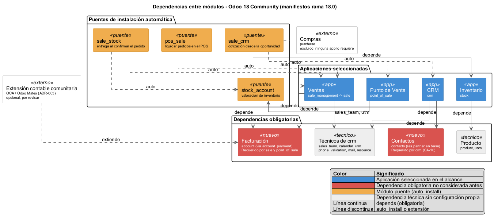

# Módulos de Odoo y dependencias obligatorias

## 1. Metadatos

* **Fecha:** 23/10/2026
* **Versión:** 0.1
* **Autores:** Diego Pinedo
* **Plataforma:** Odoo 18 Community ([ADR-002](../decisiones/ADR-002-version-y-edicion.md))

## 2. Propósito

Este documento inventaría los módulos de Odoo que componen la solución, las dependencias que cada uno instala de forma obligatoria y los módulos puente que Odoo instala automáticamente cuando coexisten dos aplicaciones. Es la fuente única para las vistas C4 y los registros de [versiones](../versiones/README.md).

La revisión se originó al identificar que el módulo `crm` requiere el módulo `contacts` ([CA-10](../versiones/VER-02-crm.md)). Se verificaron las demás aplicaciones del alcance para detectar situaciones similares.

## 3. Fuente y criterio

* `[E]` Las dependencias provienen de los archivos `__manifest__.py` de la rama `18.0` del repositorio oficial `odoo/odoo`, consultados el 23/10/2026 (claves `depends` y `auto_install`).
* Una dependencia en `depends` se instala siempre junto con el módulo; no puede omitirse.
* Un módulo con `auto_install: True` se instala solo cuando todas sus dependencias ya están instaladas; no se elige en la lista de aplicaciones.
* `[ND]` La lista de módulos instalados en la instancia del equipo no se ha contrastado todavía; ver la sección 8.

## 4. Aplicaciones seleccionadas

| Aplicación | Módulo técnico | Sistema | Rol en la solución | Estado en la arquitectura anterior |
|---|---|---|---|---|
| CRM | `crm` | CRM | Leads, oportunidades, etapas, actividades y motivos de pérdida | Considerado |
| Contactos | `contacts` | Transversal | Aplicación del maestro de cuentas y contactos (`res.partner`) | Incorporado en CA-10 solo como habilitador del CRM |
| Ventas | `sale_management` (sobre `sale`) | ERP | Cotizaciones y pedidos | Considerado como `sale` |
| Punto de Venta | `point_of_sale` | ERP | Venta de mostrador en la Tienda | Considerado sin sus dependencias |
| Inventario | `stock` | ERP | Existencias y movimientos en Tienda, Almacén 1 y Almacén 2 | Considerado |
| Facturación | `account` | ERP | Diarios, facturas internas, pagos y asientos | **No considerado**: se asumía que la contabilidad dependía solo del módulo comunitario |
| Extensión contable | Módulo comunitario OCA u Odoo Mates | ERP | Menús e informes contables adicionales | Considerado ([ADR-003](../decisiones/ADR-003-contabilidad.md)) |

## 5. Dependencias obligatorias

| Módulo | Dependencias directas (`depends`) | Efecto para MIGAL |
|---|---|---|
| `crm` | `base_setup`, `sales_team`, `mail`, `calendar`, `resource`, `utm`, `web_tour`, `contacts`, `digest`, `phone_validation` | Instalar el CRM instala Contactos, Equipos de venta, Calendario, UTM y validación de teléfonos |
| `contacts` | `base`, `mail` | Aporta la aplicación y el menú; el modelo `res.partner` pertenece a `base` y lo comparten todas las aplicaciones |
| `sale_management` | `sale`, `digest` | Es la aplicación Ventas que aparece en el menú; `sale` es su base técnica |
| `sale` | `sales_team`, `account_payment` (que depende de `account` y `payment`), `utm` | **Ventas no puede instalarse sin Facturación** |
| `point_of_sale` | `stock_account`, `barcodes`, `web_editor`, `digest`, `phone_validation` | **Punto de Venta no puede instalarse sin Inventario ni Facturación**, porque `stock_account` depende de `stock` y `account` |
| `stock` | `product`, `barcodes_gs1_nomenclature`, `digest` | Inventario no requiere Compras ni Facturación |

## 6. Módulos puente de instalación automática

| Módulo puente | Se instala cuando coexisten | Función | Uso en la arquitectura |
|---|---|---|---|
| `sale_crm` | `sale` y `crm` | Crea cotizaciones desde la oportunidad y las enlaza con ella | Frontera F-02 de [INT-01](../integraciones/INT-01-CRM-ERP.md) |
| `stock_account` | `stock` y `account` | Valoración de inventario y asientos de existencias | Dependencia obligatoria del Punto de Venta; base de la valoración pendiente de validar (CA-07) |
| `sale_stock` | `sale` y `stock_account` | Genera la entrega (`stock.picking`) al confirmar el pedido | Hace posible que `action_confirm()` genere la entrega por ubicación |
| `pos_sale` | `point_of_sale` y `sale_management` | Permite cargar y liquidar cotizaciones y pedidos de Ventas desde el Punto de Venta | Segunda vía para cobrar un pedido; requiere regla de uso (RSK-11) |

## 7. Hallazgos

| ID | Hallazgo | Consecuencia en la arquitectura | Registro |
|---|---|---|---|
| H-01 | `crm` requiere `contacts`, `sales_team`, `calendar`, `utm` y `phone_validation` | Contactos deja de ser opcional; las demás dependencias se instalan aunque no se configuren | [CA-10 y CA-18 de VER-02](../versiones/VER-02-crm.md) |
| H-02 | `sale` requiere `account` mediante `account_payment` | Facturación forma parte del ERP base desde que se instala Ventas, independientemente de [ADR-003](../decisiones/ADR-003-contabilidad.md) | [VER-01](../versiones/VER-01-erp-base.md) |
| H-03 | `point_of_sale` requiere `stock_account` y, por tanto, `stock` y `account` | El Punto de Venta no es independiente: su descuento automático de stock (CA-06) descansa en Inventario y Facturación | [VER-01](../versiones/VER-01-erp-base.md) |
| H-04 | La entrega al confirmar el pedido la aporta `sale_stock`, no `sale` ni `stock` por separado | Las vistas de componentes deben atribuir `action_confirm()` y la generación de `stock.picking` al puente | Vistas C4 |
| H-05 | `stock_account` se instala automáticamente | La valoración contable no depende de instalar un módulo, sino de configurar la categoría de producto y la contabilidad; CA-07 sigue pendiente en ese sentido | [VER-01](../versiones/VER-01-erp-base.md) |
| H-06 | `pos_sale` se instala automáticamente al coexistir Ventas y Punto de Venta | Un pedido de Ventas puede liquidarse desde el Punto de Venta; debe definirse si se permite | [RSK-11](riesgos-y-controles.md) |
| H-07 | Facturación permite crear facturas y boletas internas (`account.move`) | Riesgo de confundirlas con comprobantes de KeyFacil, que conserva la emisión fiscal ([ADR-004](../decisiones/ADR-004-odoo-community-fronteras-crm-erp.md)) | [RSK-10](riesgos-y-controles.md) |
| H-08 | Ninguna aplicación del alcance depende de `purchase` | La exclusión de Compras se mantiene; sin `purchase_stock` las reglas de reabastecimiento no generan solicitudes de presupuesto (CA-04) | Sin cambio |

## 8. Pendientes de verificación en la instancia

* Contrastar la lista de módulos instalados (Aplicaciones, filtro Instalados) con las secciones 4 a 6.
* Definir el plan contable y la configuración mínima de Facturación, y si las facturas de Odoo se usan o se restringen (RSK-10).
* Verificar si la extensión contable comunitaria es necesaria una vez instalado `account`; corresponde a la revisión de [ADR-003](../decisiones/ADR-003-contabilidad.md) con su autora.
* Decidir si `pos_sale` se usa para cobrar pedidos en mostrador o se restringe por procedimiento (RSK-11).
* Revisar los grupos de acceso que añaden `account`, `sales_team` y `point_of_sale` frente al [modelo de autorización](../seguridad/modelo-autorizacion.md).

## 9. Vista

Fuente editable: [`modulos.puml`](../vistas/dependencias/fuentes/modulos.puml).

## 10. Historial de cambios

| Versión | Fecha | Autor | Cambio |
|---|---|---|---|
| 0.1 | 23/10/2026 | Diego Pinedo | Versión inicial a partir de los manifiestos de Odoo 18.0 |
