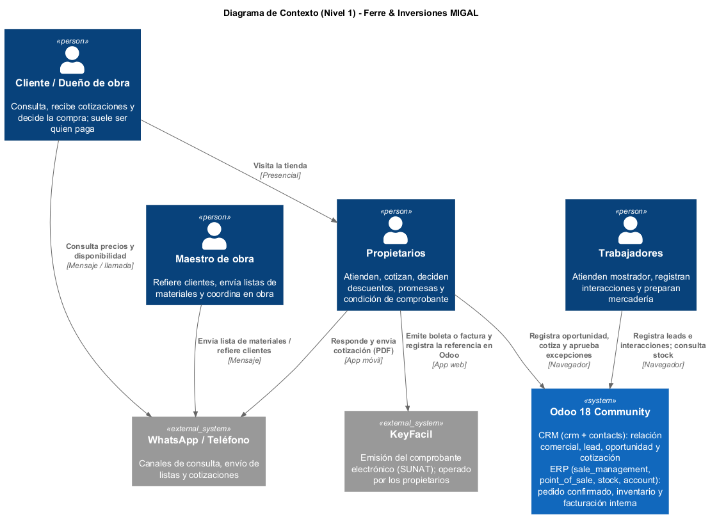
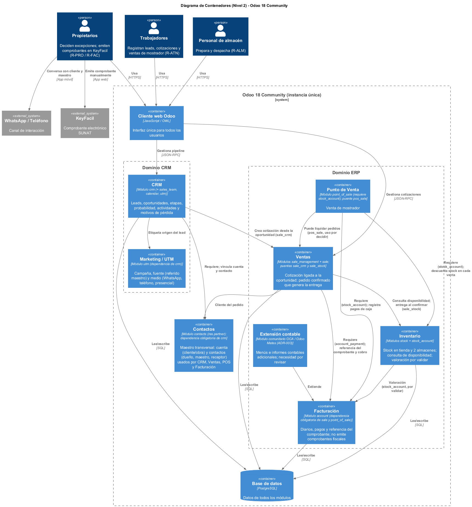
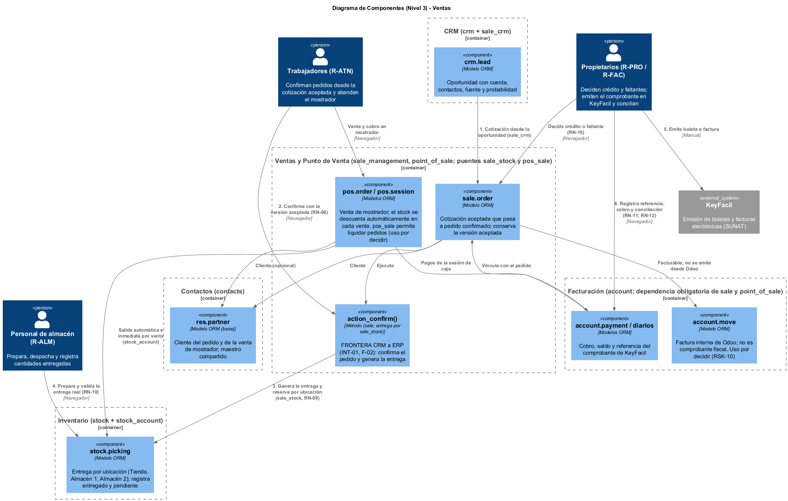
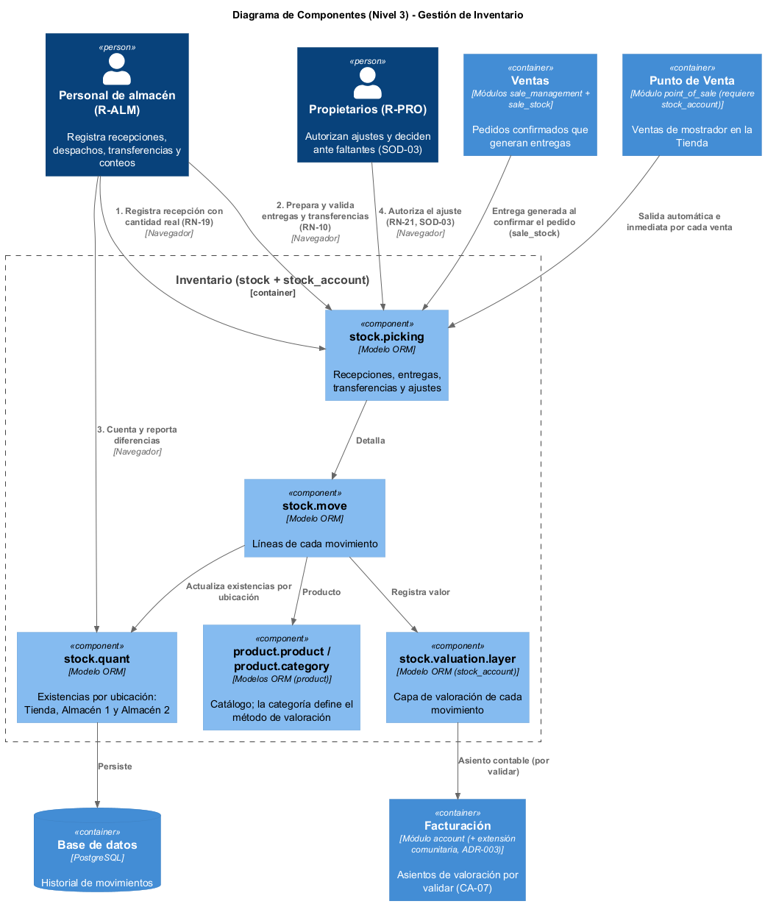
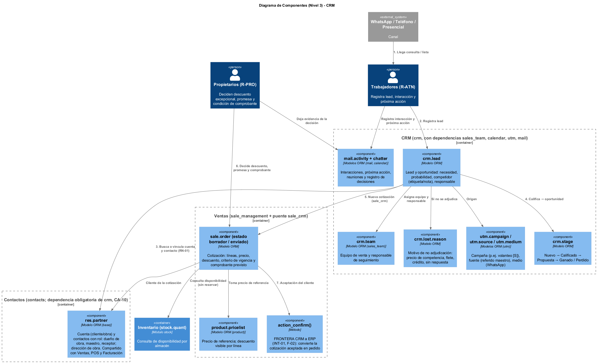

# Arquitectura del Sistema

Para plasmar la arquitectura del sistema ERP de Ferre & Inversiones MIGAL, se ha adoptado el Modelo C4 (Context, Containers, Components, Code), complementado con una vista de dependencias entre módulos de Odoo.

## 1. Diagrama de Contexto (Nivel 1)

Ofrece la visión más general del sistema. Define los límites arquitectónicos de Odoo 18 Community, con los módulos que componen el CRM y el ERP, y cómo interactúa con los usuarios clave y los sistemas externos.

---

## 2. Diagrama de Contenedores (Nivel 2)

Expone la infraestructura técnica subyacente: el cliente web, la base de datos centralizada en PostgreSQL y los contenedores lógicos correspondientes a los módulos seleccionados. Contactos se representa como maestro transversal, porque es dependencia obligatoria del CRM y lo usan también Ventas, Punto de Venta y Facturación. Facturación (`account`) aparece como dependencia obligatoria de Ventas y Punto de Venta, y la extensión contable comunitaria ([ADR-003](../decisiones/ADR-003-contabilidad.md)) como complemento.

---

## 3. Diagramas de Componentes (Nivel 3)

Profundiza en los contenedores específicos para revelar los componentes internos (modelos ORM y controladores lógicos) que ejecutan los flujos de negocio principales.

### 3.1. Order to Cash

Muestra la confirmación del pedido desde la cotización aceptada (frontera CRM a ERP, [INT-01](../integraciones/INT-01-CRM-ERP.md)), la entrega por ubicación generada por el puente `sale_stock`, la venta de mostrador con descuento automático de stock y el registro de la referencia del comprobante emitido en KeyFacil en Facturación. Odoo no emite comprobantes fiscales ([ADR-004](../decisiones/ADR-004-odoo-community-fronteras-crm-erp.md)); el uso de `account.move` y de `pos_sale` queda por decidir (RSK-10 y RSK-11 en el [registro de riesgos](../base/riesgos-y-controles.md)). Flujo detallado: [O2C](../../procesos/o2c/flujo.md).

### 3.2. Gestión de inventario

Muestra recepciones, entregas, transferencias y ajustes por ubicación (Tienda, Almacén 1 y Almacén 2). Los ajustes requieren autorización de un propietario (SOD-03). La valoración la aporta `stock_account`, instalado automáticamente; su configuración y los asientos automáticos quedan por validar (CA-07). Flujo detallado: [inventario](../../procesos/inventario/flujo.md).

### 3.3. Escenario CRM previo al pedido

Muestra el recorrido comercial dentro del CRM de Odoo 18 Community: lead, calificación, equipo de venta, actividades, cotización y motivos de pérdida. Cuenta y contactos (`res.partner`) pertenecen al módulo Contactos, dependencia obligatoria del CRM (CA-10). El método `action_confirm()` marca la frontera conceptual: hasta la cotización el CRM conserva el contexto comercial; desde la confirmación, el ERP compromete y ejecuta (ver ADR-004).

---

## 4. Dependencias entre módulos

Muestra las aplicaciones seleccionadas, las dependencias que instalan de forma obligatoria y los módulos puente que Odoo instala automáticamente. Detalle y hallazgos: [módulos y dependencias](../base/modulos-y-dependencias.md).

