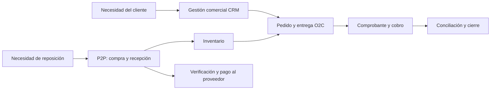

# Mapa de procesos de nivel 1

**Fecha:** 23/10/2026.
**Estado:** clasificación TO-BE propuesta; no acredita departamentos formales ni procesos aprobados. Fuente de contexto: [FN-01/FN-02](../../fuentes/fuentes-negocio.md).

## Procesos y propósito

| Grupo | Proceso funcional | Entrada → salida | Responsabilidad funcional |
|---|---|---|---|
| Dirección | Planificación comercial y decisiones del negocio | Necesidades/resultados → prioridades y condiciones | Propietarios |
| Core | Gestión comercial CRM | Interés/consulta → cotización aceptada, perdida o cancelada | R-ATN / R-PRO |
| Core | Order to Cash | Necesidad comercial → entrega y cobro conciliados, o excepción documentada | R-ATN, R-ALM, R-PRO y R-FAC |
| Core | Procure to Pay | Necesidad de abastecimiento → recepción y pago conciliados, o excepción | Propietarios, almacén y administración funcional |
| Core compartido | Gestión de inventario | Entradas, salidas y reservas → existencia confiable por ubicación | Personal operativo / propietarios |
| Soporte | Registro económico y conciliación | Operaciones/comprobantes → saldos y conciliaciones | Propietarios y apoyo contable según función validada |
| Soporte | Datos, accesos y continuidad | Necesidades de información/acceso → registros confiables y servicio recuperable | Propietarios; soporte técnico por definir |

La agrupación es analítica. Una misma persona puede ejecutar varias funciones; el [modelo de autorización](../../arquitectura/seguridad/modelo-autorizacion.md) propone controles sobre operaciones incompatibles. Inventario conecta ventas y abastecimiento, pero no reemplaza P2P. CRM es el tramo comercial de entrada a O2C, no un segundo proceso de venta desconectado.

## Documentos por proceso

| Proceso | Documentos |
|---|---|
| Gestión comercial CRM | [Flujo comercial](../comercial-crm/flujo-comercial.md) |
| Order to Cash | [SIPOC](../o2c/sipoc.md), [flujo](../o2c/flujo.md), [pedido](../o2c/pedido.md), [facturación](../o2c/facturacion.md) |
| Procure to Pay | [SIPOC](../p2p/sipoc.md), [flujo](../p2p/flujo.md) |
| Gestión de inventario | [Flujo](../inventario/flujo.md) |

Las reglas de todos los procesos están en el [catálogo de reglas](../catalogo-reglas.md).

## Puntos de control compartidos

- La aceptación del cliente no equivale a la confirmación del ERP.
- La solicitud de pedido y la respuesta del ERP deben quedar trazables.
- Las existencias disponibles, las reservas y las promesas de entrega deben distinguirse de las ventas confirmadas.
- Misma identidad de producto y unidad entre oferta, abastecimiento y movimiento.
- Aceptación y autorizaciones documentadas antes de compromisos que las requieran.
- Diferencias de recepción/entrega visibles, sin ajustar silenciosamente cantidades.
- Comprobantes y pagos separados de documentos operativos y conciliados por referencia.
- Una misma persona puede desempeñar varias funciones; esta clasificación no implica la existencia de departamentos formales.
- La agrupación de procesos es analítica y no constituye una estructura organizacional aprobada.

## Pendientes de validación

Revisar con los propietarios la clasificación, los puntos de inicio y fin y las tareas reales, y asignar cada perfil a personas. Véanse [O2C](../o2c/sipoc.md), [P2P](../p2p/sipoc.md), [inventario](../inventario/flujo.md) y [alcance](../../arquitectura/base/alcance.md).
